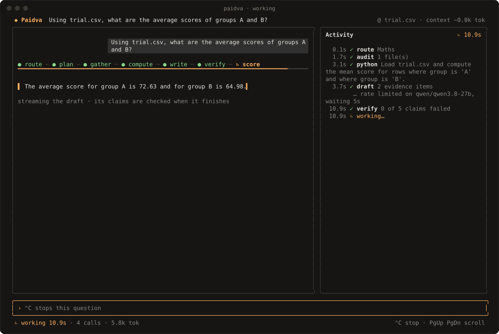
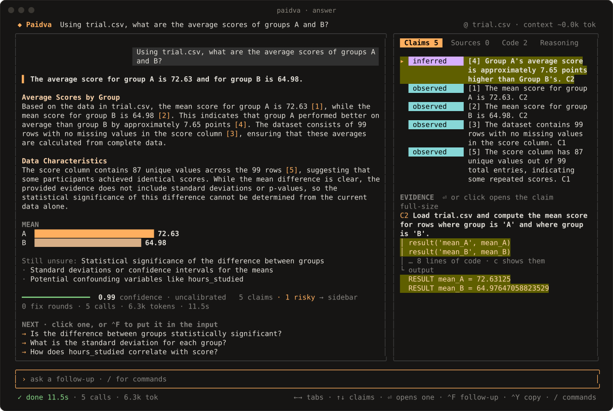
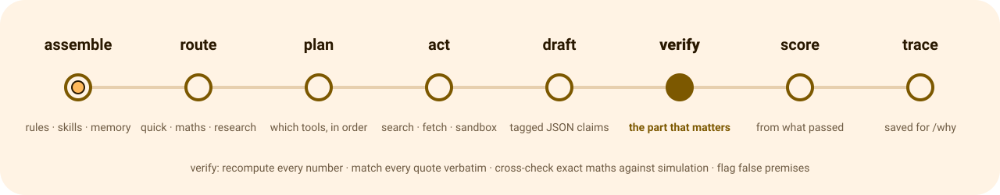

<div align="center">

<picture>
  <source media="(prefers-color-scheme: dark)" srcset="assets/hero-dark.svg">
  
</picture>

<br>

[](LICENSE)
[](#install)
[](#recommended-run-the-model-on-your-mac)

**A research and statistics agent for your terminal that shows its work.**
Every number comes from sandboxed Python, every quote is matched word for word, and confidence is computed from what passed the checks. Runs fully on your Mac with Qwen 3.5 9B, or on free cloud models.

**[Install](#install)** · **[What you see](#what-you-see)** · **[Why](#why-paidva)** · **[Results](#results)** · **[Commands](#commands)**

</div>

## Install

You need a Mac and [uv](https://docs.astral.sh/uv/) (for the Python sandbox). Then:

```bash
curl -fsSL https://raw.githubusercontent.com/dev-the-dev-while-deving/paidva-research-agent/main/install.sh | sh
paidva
```

The first run is a short setup: workspace, model, optional keys, sandbox. Paidva tells you when a new version is out; `paidva update` installs it.

### Recommended: run the model on your Mac

Paidva works best with **Qwen 3.5 9B** running locally through [Ollama](https://ollama.com). Install both yourself:

```bash
brew install ollama
ollama pull qwen3.5:9b-q4_K_M
```

Paidva finds it on its own and uses it first (setup and `paidva settings` › Local model let you switch it off).

| | Local (Qwen 3.5 9B) | Cloud (free tiers) |
|---|---|---|
| Privacy | Questions and data never leave your Mac | Sent to the provider |
| Limits | None | Groq: 200k tokens a day; one request can't exceed ~8k tokens |
| Keys | None needed | One free key (Groq, Gemini or OpenRouter) |
| Speed | About 1–4 minutes an answer | About 10–60 seconds |
| Needs | 16 GB+ of memory (6.6 GB download); 8–12 GB Macs get the 4B model (3.3 GB) | Internet |

Why Qwen 3.5 9B: among models that fit in about 10 GB, it scores best on what Paidva leans on most (multi-step agent tasks 87%, graduate-level science 81%, long-context reasoning 70% on Artificial Analysis), and it beats gpt-oss-20b there at half the size. Use the **`-q4_K_M`** build: Ollama's default `qwen3.5:9b` tag runs on its MLX runner, which can't do the structured output Paidva checks every answer with.

Cloud keys still help as fallbacks (Paidva moves to them if the local model fails), and the second opinion on hard questions comes from a different model family. Switch any time with `/model`.

**Web search** is optional: add a free [Tavily](https://app.tavily.com) key (1,000 searches a month) in `paidva settings`, and Paidva searches the open web as well as Wikipedia, arXiv and Semantic Scholar. Web pages get the same word-for-word quote check as papers.


## What you see



While it works, you see each stage, every step on the right, and the answer as it's written.



The answer is a short summary, then headed sections with [n] citations (click one to open that claim) and charts for the numbers it computed. Every sentence must restate a verified claim: a sentence with a number no claim backs is deleted. Suggested follow-ups sit underneath. Every claim is in the sidebar, **riskiest first**: pick one to see the exact code or source sentence behind it. The **Reasoning** tab shows how it got there, including what verification caught and the model's own thinking.

Chats save automatically: `/resume` reopens one, and typing `/` shows every command.

## Why Paidva

| The usual problem | What Paidva does |
|---|---|
| Citations that don't back the claim | The quote must appear **word for word** in the source, and a separate checker must agree it supports the claim |
| Confidence that means nothing | Confidence is **computed from what passed verification**, never stated by the model |
| Maths nobody checked | Numbers come from **sandboxed Python**; probability answers are cross-checked by simulation |

Every claim carries a tag: `observed` (from code it ran), `sourced` (quoted from a paper), `inferred`, `knowledge` or `speculation`. Claims that fail a check are fixed or downgraded, and confidence drops with them. **The model proposes, code decides.**

<picture>
  <source media="(prefers-color-scheme: dark)" srcset="assets/pipeline-dark.svg">
  
</picture>

## Results

<picture>
  <source media="(prefers-color-scheme: dark)" srcset="assets/results-dark.svg">
  
</picture>

Same pinned model, alone vs. inside Paidva (first eval round, 2026-11-19):

- ✅ **Zero dead citations** in every Paidva run (plain models: 11–20%).
- ✅ **Confidence becomes useful:** on the hard set, the most-confident answers went from 38% right to 80% right.
- ⚠️ **Not yet significant** (free-tier limits allowed only 8–16 shared questions), and it costs 10–25× the tokens.

<details>
<summary>Full table</summary>

| Set · model | System | Accuracy | Most-confident half right | Calibration error | Dead citations |
|---|---|---|---|---|---|
| Dev · qwen3.8-27b | plain | 65% | 78% | 0.34 | 2/10 |
| Dev · qwen3.8-27b | **Paidva** | **87%** | **100%** | **0.13** | **0/17** |
| Hard · qwen3.8-27b | plain | 33% | 38% | 0.64 | 0/1 |
| Hard · qwen3.8-27b | **Paidva** | **44%** | **80%** | **0.24** | **0/27** |
| Dev · gpt-oss-120b | plain | 91% | 100% | 0.14 | 4/36 |
| Dev · gpt-oss-120b | **Paidva** | **94%** | 100% | **0.07** | **0/111** |

The hard set is a held-out test and is deliberately not published.

</details>

## Commands

| | |
|---|---|
| `paidva` | Chat (setup runs first if there's no key yet) |
| `paidva ask "…" [--file data.csv] [--deep] [--json]` | One question, then exit |
| `paidva watch` | Re-run watched questions and note what changed (`--install` schedules it daily) |
| `paidva update` | Install the latest release |
| `paidva settings` · `paidva doctor` | Change keys, models and more · health check |
| `paidva eval` · `paidva report` | Run and compare evals on your own question sets |

In the chat, typing always goes to the input and `/` opens the command menu:

| | |
|---|---|
| `/deep <question>` | More searches and sources, an extra verification round, and a second opinion from another model |
| `/model` · `/model fast` | Switch models: local Ollama models and everything your keys can use |
| `/skills` · `/skills new <name>` | See and edit skills (how Paidva handles a kind of question), or write your own |
| `/rules` · `/rules add <text>` | See and edit the rules every answer follows, or add one |
| `/file` · `/resume` · `/watch` · `/export` · `/copy` | Attach data · reopen a chat · re-run a question daily · save as Markdown · copy |

 With the input empty, **←→** switch sidebar tabs and **↑↓** pick a claim; **⏎** or a click opens it full-size with its evidence. In the pop-up, **x** marks a claim wrong (saved as feedback for Paidva's self-improvement loop). **⌃F** puts a suggested follow-up in the input, **⌃Y** copies, **⌃C** stops a run and `/help` shows every key. The mouse works too; **⌃O** switches it off so a plain drag selects text (and back on).

Long chats stay fast: older turns are compacted into a running summary, and the header shows how much context the next question carries. Settings live in `~/.agent/config.toml` (models, `[budget]` for evidence size and second opinions); prompts, rules and skills in `~/.agent/` are plain files you can edit, and upgrades never overwrite ones you've changed. Set `ui.tui = false` for the plain line mode, or `ui.check_updates = false` to turn off the once-a-day update check.

## Roadmap

- **V1 (now):** beat the same model on its own, with verified citations and calibrated confidence.
- **V2:** the agent proposes its own rule and prompt changes from failed traces; you approve each one.
- **V3:** does self-improvement compound round after round, or stall?

## License

Paidva is free to download and use. The source code is not public: see [LICENSE](LICENSE). Versions up to v0.5.1 were published under AGPL-3.0, and copies of those versions remain under that licence.

Found a bug or have an idea? [Open an issue](https://github.com/dev-the-dev-while-deving/paidva-research-agent/issues).

<div align="center">
<br>
<sub>Built by <a href="https://github.com/dev-the-dev-while-deving">Devarshee Mude</a> · runs on free tiers · $0/month</sub>
</div>
