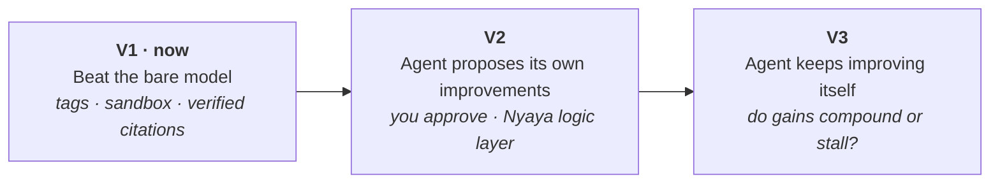

<div align="center">

<picture>
  <source media="(prefers-color-scheme: dark)" srcset="assets/hero-dark.svg">
  
</picture>

<br>

[](LICENSE)
[](https://www.rust-lang.org)
[](#-quick-start)
[](#-results)

**[Why](#-why-paidva)** · **[How it works](#-how-it-works)** · **[Results](#-results)** · **[Quick start](#-quick-start)** · **[Roadmap](#-roadmap)** · **[Contributing](#-contributing)**

</div>

---

## ✦ Why Paidva

Ask an AI research tool a question and you get a confident paragraph with links. Look closer and three things go wrong:

| The problem | What Paidva does instead |
|---|---|
| **Citations that don't back the claim.** The link works, but the page doesn't say that. | Every quote must appear **word for word** in the fetched source. Then a separate checker, which sees only the claim and the passage, must agree that the passage supports it. |
| **Confidence that means nothing.** "95% sure" and wrong. | Confidence is **computed from what passed verification**, not stated by the model. Sort by it and check the low ones first. |
| **Maths nobody checked.** The tool shows you code, but nobody verifies it. | Every number comes from **sandboxed Python**, and probability answers are cross-checked against a simulation. |

The rule behind all of it: **the model proposes, code decides.** Any check that *can* be code *is* code.

## ✦ Every claim carries a tag

| | Tag | Where it came from | How it's checked |
|---|---|---|---|
| 🟦 | `observed` | Code the agent ran | The number must appear in the sandbox output |
| 🟩 | `sourced` | A paper or page | Verbatim quote match, then an independent support check |
| 🟪 | `inferred` | Reasoning from other claims | Must cite the claims it rests on |
| 🟧 | `knowledge` | The model's background knowledge | Allowed, but clearly labelled |
| ⬜ | `speculation` | A guess | Allowed, but clearly labelled |

Claims that fail verification are **fixed or downgraded** to `speculation`, and the answer's confidence drops with them. Type `/why` in chat to see the full trace: the rules loaded, the tools called, the sources read and every check that ran.

## ✦ How it works

<picture>
  <source media="(prefers-color-scheme: dark)" srcset="assets/pipeline-dark.svg">
  
</picture>

<details>
<summary><b>What happens at each stage</b></summary>

<br>

| Stage | What it does |
|---|---|
| **assemble** | Loads core rules, the contextual rules that match, skills (`SKILL.md`) and memory |
| **route** | Decides whether this needs a quick answer, maths and statistics, research, or an abstention (false premise or unknowable) |
| **plan** | Chooses which tools to use, in what order |
| **act** | Searches Wikipedia, arXiv and Semantic Scholar, fetches full-text papers, and runs Python in the sandbox |
| **draft** | Writes a structured JSON answer (enforced by a schema) in which every claim is tagged |
| **verify** | Recomputes numbers, matches quotes verbatim, runs a support check per claim, cross-checks exact maths against simulation (within 3σ, at 0.25% precision), flags false premises, and rewrites a headline that says more than the verified claims |
| **score** | Computes confidence from what passed |
| **trace** | Saves everything for `/why` and for evals |

</details>

**Under the hood**

- 🔒 **Sandboxed Python** (numpy, scipy, pandas, statsmodels, sympy, scikit-learn) under macOS `sandbox-exec`. It has no network, no access to your home folder or keys, writes only to a temp dir, and times out after 30 s. It was attack-tested against network escapes, key theft and writes to your home folder.
- 📐 **Bayesian updates and study pooling** are computed in code, never by the model.
- 📝 **Editable rulebook, skills and prompts** live in `~/.agent/` and are read at runtime, so you can tune behaviour without recompiling.
- 🔀 **Provider router** across Groq, Google AI Studio and OpenRouter, with schema-enforced output, a SQLite response cache, and back-off and fallback on rate limits.
- 🧪 **Built-in eval harness:** `plain` (the model alone) vs. `full` (Paidva) on the same pinned model, with graders, calibration error and paired McNemar tests.

## ✦ Results

<picture>
  <source media="(prefers-color-scheme: dark)" srcset="assets/results-dark.svg">
  
</picture>

First eval round, 2026-11-19. Each comparison runs the **same pinned model**, alone (`plain`) and inside Paidva (`full`).

<details>
<summary><b>Full table</b></summary>

<br>

| Set · model | System | Accuracy | Most-confident half right | Calibration error | Dead citations |
|---|---|---|---|---|---|
| Dev · qwen3.8-27b | plain | 65% | 78% | 0.34 | 2/10 |
| Dev · qwen3.8-27b | **Paidva** | **87%** | **100%** | **0.13** | **0/17** |
| Hard · qwen3.8-27b | plain | 33% | 38% | 0.64 | 0/1 |
| Hard · qwen3.8-27b | **Paidva** | **44%** | **80%** | **0.24** | **0/27** |
| Dev · gpt-oss-120b | plain | 91% | 100% | 0.14 | 4/36 |
| Dev · gpt-oss-120b | **Paidva** | **94%** | 100% | **0.07** | **0/111** |

</details>

**What it shows**
- ✅ **Zero dead citations** across every Paidva run (the plain models had 11–20%).
- ✅ **A large lift on a weaker model**, and Paidva **never lost a question** the plain model got right.
- ✅ **Confidence becomes useful.** On the hard set, plain qwen's most-confident answers were right 38% of the time, so its confidence was noise. With Paidva they were right 80% of the time.
- ➖ **On a strong model, accuracy barely moves.** The gain there is calibration and clean citations.

**What it doesn't show yet**
- ⚠️ **Not statistically significant** (paired McNemar p ≥ 0.25). Free-tier rate limits left only 8–16 shared questions per comparison.
- ⚠️ **It costs more:** 10–25× the tokens and 30–70 s per question.
- ⚠️ **Research answers are faithful but thin** (rubric 0.42–0.62), because there's no general web search yet.
- ⚠️ **Confidence weights are hand-set.** The score ranks answers well, but "0.8" doesn't yet mean 80%.

> The dev set and its results are in `evals/`. The **hard set is a held-out test and is deliberately not published**, so that it stays unseen by models and by tuning. Answer keys were computed in Python, not recalled.

## ✦ Quick start

**You need:** Rust, macOS (for `sandbox-exec`), [uv](https://docs.astral.sh/uv/), and one free API key. [Groq](https://console.groq.com) is the default; Gemini and OpenRouter also work.

```bash
git clone https://github.com/dev-the-dev-while-deving/paidva-research-agent
cd paidva-research-agent
cargo install --path .     # installs `paidva` into ~/.cargo/bin (make sure that's on your PATH)
paidva                     # first run opens the setup wizard, then the chat
```

**The setup wizard** walks you through everything in about two minutes:

1. **Workspace:** installs the prompts, rules and skills into `~/.agent`, where you can edit them.
2. **API keys:** you paste each free key into a hidden prompt. Paidva **checks it live** with the provider (a free model-list call that uses no tokens) and stores it in `~/.agent/.env`, which only you can read (mode 600).
3. **Models:** keep the recommended fallback chains or pick your own from a **searchable list of the free models your keys can use**.
4. **Python sandbox:** one confirmation installs it with uv.
5. **Health check:** ends with `paidva doctor`, so you see that everything works.

### The CLI

| Command | What it does |
|---|---|
| `paidva` | Chat (runs the setup wizard first if there are no keys yet) |
| `paidva ask "…" [--file data.csv] [--json]` | One question, then exit |
| `paidva setup` | Run the setup wizard again |
| `paidva settings` | The settings screen: keys (add, replace or remove), main and fast model chains, colours, live steps on or off, sandbox timeout, reinstall the Python sandbox or the default prompts, reset |
| `paidva doctor [--offline]` | Health check: workspace, every key (checked live), models, Python, sandbox |
| `paidva trace` | How the last answer was built |
| `paidva eval` / `paidva report` | Run and compare evals |

**Inside the chat:** live progress shows each step as it finishes (route, search, python, check, verify). Answers show colour-coded claim tags, a confidence meter, cross-checks and sources. You get line editing, persistent history (↑ and Ctrl-R) and these commands:

| | |
|---|---|
| `/why` | Plan, evidence, code, and what verification caught |
| `/sources` · `/code` · `/json` | Every source passage · the Python behind each number · the raw answer |
| `/file <path>` · `/drop` | Attach data for the analyst · detach it |
| `/settings` · `/doctor` | Change anything without leaving the chat · health check |
| `/clear` · `/help` · `/quit` | |

Settings live in `~/.agent/config.toml`, which you can also edit by hand. `NO_COLOR` is respected, and output piped to a file stays plain.

**Run the evals:**

```bash
paidva eval --set evals/dev.jsonl --system plain --model openai/gpt-oss-120b
paidva eval --set evals/dev.jsonl --system full  --model openai/gpt-oss-120b
paidva report evals/results/dev-*.jsonl
```

Model specs: `openai/gpt-oss-120b` (Groq), `gemini:<model-id>`, `openrouter:<model-id>`.

<details>
<summary><b>Project layout</b></summary>

```
src/
  main.rs      CLI: chat · ask · setup · settings · doctor · trace · eval · report
  ui.rs        colours, live progress, answer and trace views
  setup.rs     setup wizard, settings screen, doctor
  config.rs    ~/.agent/config.toml and the key store
  agent.rs     the loop: assemble → route → plan → act → draft → verify → score → trace
  answer.rs    Claim / Tag / Answer types and their invariants
  verify.rs    quote, number and inference checks
  llm.rs       OpenAI-compatible client, structured output, cache, fallback
  sandbox.rs   sandboxed Python runner
  search.rs    Wikipedia, arXiv, Semantic Scholar
  papers.rs    paper full text
  stats.rs     Bayes updates, pooling, cross-checks
  eval.rs      graders, calibration, paired comparisons
home/          default prompts, rules and skills (installed to ~/.agent)
evals/         dev question set, data, results
research/      market survey, eval-method notes, V1 field report
assets/        README artwork
```

</details>

## ✦ Roadmap



- **V1 (now):** prove the system beats the same model on its own. Next up: a tested statistics library inside the sandbox, a deterministic audit for attached data, honest failure messages, a rate-limit-aware scheduler, and 150+ eval questions with generated maths variants.
- **V2:** a nightly loop turns failed traces into one proposed rule, skill or prompt change per failure cause. Each change is tested on the dev set and then goes to you for approval. V2 also A/B tests a **Nyaya-logic layer**: evidence typed by *pramana*, a *hetvabhasa* fallacy check, and *vada*-style debate. A "no, it doesn't help" is a valid result.
- **V3:** an archive of agent variants (in the style of the Darwin Gödel Machine) that evolves small, testable units (rules, skills, examples) instead of code, plus a self-play curriculum. The research question is whether improvements **compound** round after round or stall after one.

## ✦ Contributing

Contributions are welcome, especially **new eval questions with answer keys computed in code**, sandbox hardening, retrieval sources and Linux sandbox support. See [CONTRIBUTING.md](CONTRIBUTING.md).

Two rules any change must keep: **no number without a sandbox run or a quoted source**, and **no fabricated citations**.

## ✦ License

[AGPL-3.0](LICENSE). Use it, fork it and build on it. If you run a modified version as a service, share your changes.

<div align="center">
<br>
<sub>Built by <a href="https://github.com/dev-the-dev-while-deving">Devarshee Mude</a> · runs on free tiers · $0/month</sub>
</div>
